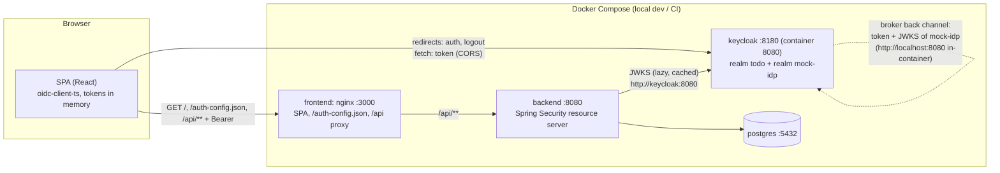
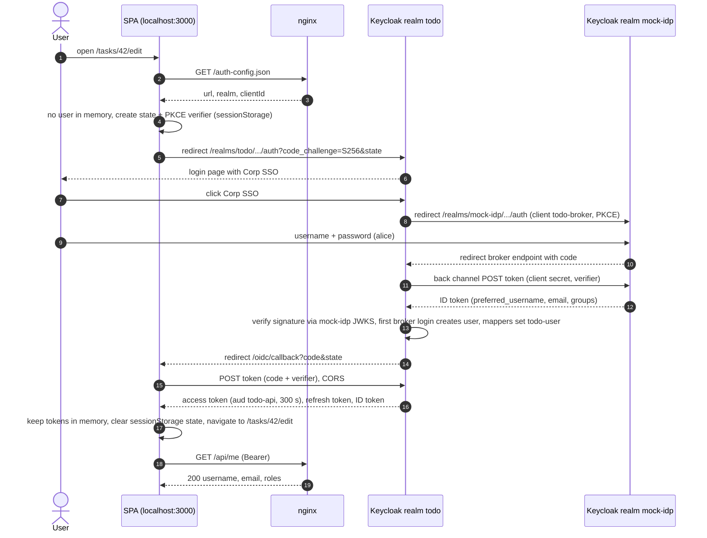
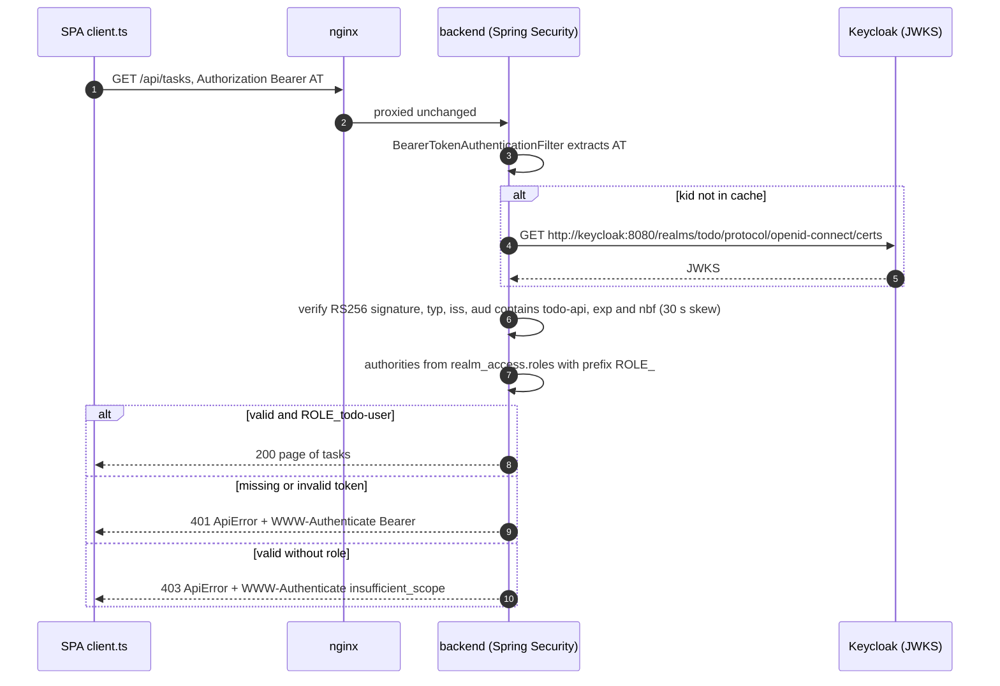
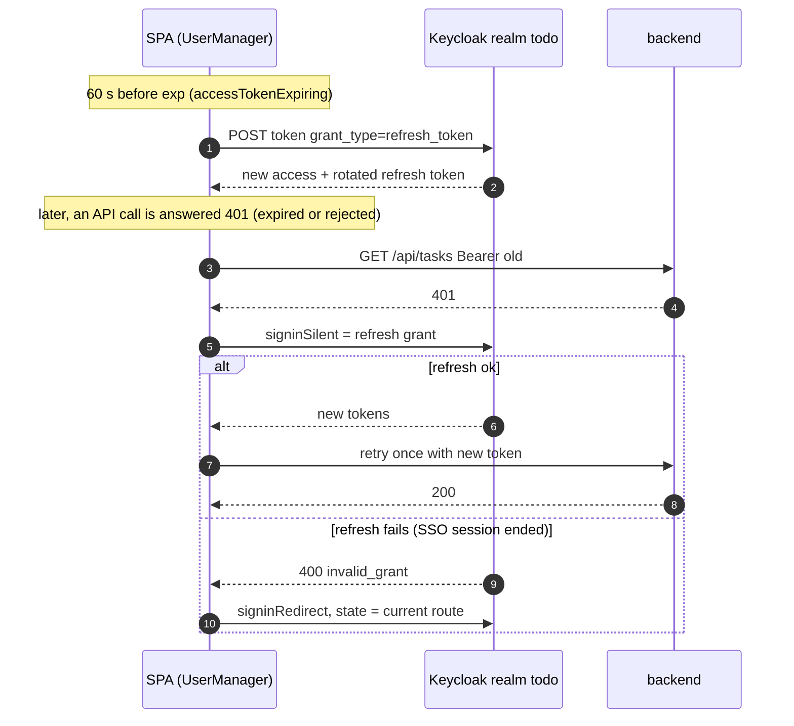
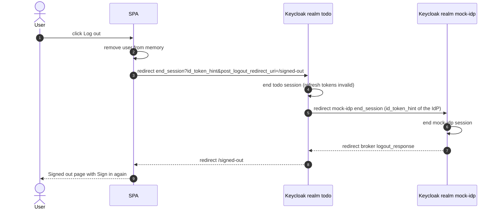

# SCRUM-13 — Design: Keycloak authentication with a mock OIDC enterprise IdP (brokering), SPA login/logout, JWT resource server

| Field | Value |
|---|---|
| Jira | [SCRUM-13](https://suranagivinod.atlassian.net/browse/SCRUM-13) |
| Requirements | [`docs/requirements/SCRUM-13.md`](../requirements/SCRUM-13.md) (SCRUM-13-AC-01..AC-36, NFR-01..NFR-11, Q-01..Q-10) |
| ADRs | **new [ADR 0018](../adr/0018-authentication-keycloak-oidc.md)** (authentication architecture), **new [ADR 0019](../adr/0019-mock-enterprise-idp-brokering.md)** (mock IdP + brokering); amended: [0003](../adr/0003-error-response-format.md), [0006](../adr/0006-frontend-api-client-and-state.md), [0007](../adr/0007-frontend-testing-msw.md), [0011](../adr/0011-spa-hosting-nginx-reverse-proxy.md), [0012](../adr/0012-end-to-end-testing-playwright.md), [0015](../adr/0015-pre-release-e2e-gate.md), [0017](../adr/0017-api-contract-openapi.md); unchanged but relevant: [0004](../adr/0004-traceability-conventions.md), [0010](../adr/0010-container-images-and-build-identity.md), [0014](../adr/0014-vulnerability-scanning-policy.md) |
| Author role | Architect |
| Inputs | `main` `682ea5f`; upstream read on 2026-11-25: `keycloak/keycloak` tags (`26.8.2` = `e514445f9d`), release asset `keycloak-26.8.2.tar.gz` (downloaded, SHA-1 matched the published `.sha1`); `spring-projects/spring-boot` tag `v4.1.2` (`634e6fd6bc`, sparse clone: `starter/`, `module/spring-boot-security*`, `module/spring-boot-webmvc-test`, `platform/spring-boot-dependencies`); `spring-projects/spring-security` tag `7.1.2` (raw files: `JwtValidators`, `JwtTypeValidator`, `ExpressionJwtGrantedAuthoritiesConverter`, `CorsConfigurer`, `libs.versions.toml`); npm registry (`npm view`); oasdiff 1.39.0 (pinned in `install-tools.sh`). **Spike:** Keycloak 26.8.2 run natively with both realm files (§2.3). |

## 1. Decisions at a glance

| Topic (question) | Decision | Why (short) |
|---|---|---|
| Issuer / hostname topology (Q-01) | **Keycloak on its own origin `http://localhost:8180`** (`TODO_KEYCLOAK_PORT`), **fixed** `KC_HOSTNAME=http://localhost:8180` → one issuer `http://localhost:8180/realms/todo` for every client. Backend: `issuer-uri` = public URL (validated), `jwk-set-uri` = internal `http://keycloak:8080/…/certs` (keys). Pure Boot configuration: with both properties Boot 4.1.2 builds the decoder from `jwk-set-uri` and still adds `JwtIssuerValidator(issuer-uri)`. | Single issuer in Compose, Vite dev mode, `mvnw` backend, e2e runner, curl; no discovery call → no start-up dependency on Keycloak (NFR-06); Keycloak pages keep their own headers; IdP and app are separate origins (trust boundary) but **same-site** (`localhost`), so no third-party-cookie issues. Same-origin `/auth` proxy rejected (ADR 0018 §1). |
| CSP (AC-16, NFR-05) | Only change: `connect-src 'self' <AUTH_URL>/`. No `frame-src` (no iframes at all), `form-action 'self'` and `frame-ancestors 'none'` unchanged. | Login/logout are top-level navigations (`location.assign`), renewal is a `fetch` to the token endpoint. Spike: zero console/CSP errors with exactly this policy. |
| Frontend library (Q-02) | **`oidc-client-ts` 3.5.0** + **`react-oidc-context` 3.3.1**; Authorization Code + PKCE S256; `userStore: InMemoryWebStorage`; `stateStore: sessionStorage` (transient state/verifier only); `automaticSilentRenew` via **refresh-token grant**; `monitorSession: false`; reload = top-level SSO bounce. | Standards-based, explicit storage control, no iframes; spike-verified (login, deep link preserved, renew ×2 with rotation, reload without credentials, logout, empty storage). `keycloak-js` 26.2.5 considered (ADR 0018 §2). |
| Runtime SPA config (Q-03, AC-16) | nginx serves **`/auth-config.json`** rendered from env `AUTH_URL`/`AUTH_REALM`/`AUTH_CLIENT_ID` (validated by a new entrypoint script); the SPA (built with `VITE_AUTH_CONFIG_URL=/auth-config.json`) fetches it before rendering. Vite dev: `VITE_AUTH_*` with defaults. | Image stays environment-agnostic, like `BACKEND_URL`. Spike: `add_header` with a `set` variable and `return 200 '<json>'` work in nginx. |
| Backend (Q-04) | **`spring-boot-starter-security-oauth2-resource-server`** (Boot 4 name; the `spring-boot-starter-oauth2-resource-server` alias is deprecated in 4.1.2). Properties: `issuer-uri`, `jwk-set-uri`, `audiences: [todo-api]`, `authorities-claim-expressions: "['realm_access']['roles']"`, `authority-prefix: ROLE_`, `principal-claim-name: preferred_username`; `JwtTimestampValidator(30s)` bean; one `SecurityFilterChain`; entry point / access-denied handler writing `ApiError`. `/api/me` (auth only), `/api/**` → `ROLE_todo-user`, health/info public, rest authenticated. Stateless, CSRF off, `cors(withDefaults())`. | Configuration over code; RFC 6750 headers from Spring's own handlers; ADR 0003 bodies; preflight unauthenticated; anonymous enumeration impossible. |
| `/actuator/info` (Q-04) | Stays **public** on the backend port (unchanged; not proxied by nginx, SCRUM-7 Q-05). | Build identity only; e2e/release checks read it without a token. |
| `/api/me` (Q-10) | `{subject, username, email\|null, name\|null, roles[]}`; roles = `realm_access.roles` ∩ `app.auth.roles` (`todo-user`, `todo-admin`), sorted. Requires authentication, not the role. | The 403 page can show who is signed in; stable contract independent of Keycloak default roles (which are also scoped out, ADR 0019 §2). |
| Contract (Q-05) | springdoc annotations: `@SecurityScheme("bearerAuth", HTTP bearer JWT)` + `@SecurityRequirement` on both controllers; 401 everywhere, 403 on Task operations, `WWW-Authenticate` header required; `getCurrentUser`. oasdiff: **6 ERR** `api-security-anonymous-access-removed` (verified) → 6 `SCRUM-13` ack lines (§6.3). Conformance/ITs authenticate with tokens minted by a test JWKS server (JDK `HttpServer`) — no Keycloak in backend tests. | Real decoder path (JWKS fetch, `kid`) under test; exact ack lines known in advance. |
| Compose (Q-06) | `keycloak` service **without profile** (plain `docker compose up -d` = PostgreSQL + Keycloak), pinned `quay.io/keycloak/keycloak:26.8.2@sha256:<digest>`, `start-dev --import-realm`, embedded dev-file DB (ephemeral), realms bind-mounted read-only, healthcheck via bash `/dev/tcp` on management port 9000, `cap_drop: [ALL]`, `no-new-privileges`; **not** `read_only` (start-dev re-augments into `/opt/keycloak/lib`). Frontend `depends_on` keycloak healthy; backend does not. | Local backend and Vite need Keycloak; realms-as-code make state disposable; spike start ≈ 38 s cold (20 s augmentation). |
| Logout (Q-07) | RP-initiated logout with `id_token_hint`, **propagated to the mock IdP** (`logoutUrl`, `sendIdTokenOnLogout`) → `/signed-out`. E2E asserts the next login shows the IdP form again. | Spike: both realms' sessions → 0, refresh token `invalid_grant`. ADR 0019 §2. |
| E2E (Q-08) | Setup project does **one brokered UI login** (alice) → `storageState` (Keycloak SSO cookies) reused by `empty-state`/`ui`/`dev-smoke`; API set-up, `http` tests and `verify-lifecycle.sh` use **client-credentials** tokens (`todo-e2e`); dedicated `auth` project (fresh contexts): deep-link redirect, logout propagation, 403 page (carol), renewal (`page.clock.fastForward`), expired-token recovery (real expired token from client `todo-e2e-short`, 5 s lifetime, injected once via `page.route`); `e2e-gate --min 12 → 19`. | Brokered path proven once per run (and in detail in `auth`); everything else fast and deterministic. |
| Trivy / release scope (Q-09) | Keycloak image **out of release-scan scope** (third-party dev/CI dependency like `postgres`), never built/pushed; `check-compose-images.sh` asserts it is pinned by digest. | ADR 0014 gates what we ship; the release has no Keycloak. Optional informational scan = follow-up. |
| Ownership / admin ops | **Out of scope**: tasks stay global; `todo-admin` grants nothing yet. | Keeps the story to authentication; follow-ups recorded (§15). |

## 2. Evidence: versions, compatibility, spike

### 2.1 Versions

| Component | Version | Verified how |
|---|---|---|
| Keycloak (server, image) | **26.8.2** | `git ls-remote --tags` (newest stable tag; `26.8.0/1/2`, `26.7.x`, `26.6.x`); release asset `keycloak-26.8.2.tar.gz` downloaded, SHA-1 `7918de2786c7db466152128bea350becbd40a58f` = published `.sha1`, SHA-256 `dd124787283918bc597628887168333465ee2a811a389e0003569e52be7e487f`; runs on Quarkus 3.40.1.1. Image `quay.io/keycloak/keycloak:26.8.2`: quay.io is **not reachable** from the sandbox — Dev records the digest from the first CI run (§11.1, R-01). |
| Spring Boot starter | `spring-boot-starter-security-oauth2-resource-server` (BOM 4.1.2) | `starter/spring-boot-starter-security-oauth2-resource-server/build.gradle` @ v4.1.2: `spring-boot-starter-security` + `module:spring-boot-security-oauth2-resource-server` (→ `spring-security-oauth2-jose`, `-resource-server`). `starter/spring-boot-starter-oauth2-resource-server`: description "deprecated in favor of spring-boot-starter-security-oauth2-resource-server". |
| Spring Boot test starter | `spring-boot-starter-security-oauth2-resource-server-test` (test) | = resource-server starter + `spring-boot-starter-security-test` (→ `module:spring-boot-security-test`, whose `WebMvcTest.includes` adds `SecurityFilterChain`/`WebSecurityCustomizer` **beans of component type** and `SecurityMockMvcAutoConfiguration`) + `spring-boot-starter-test`. |
| Spring Security | **7.1.2** | `platform/spring-boot-dependencies/build.gradle`: `library("Spring Security", "7.1.2")`. |
| Nimbus JOSE+JWT | **10.9.1** (transitive, not Boot-managed) | spring-security `7.1.2` `gradle/libs.versions.toml`: `com.nimbusds:nimbus-jose-jwt:10.9.1`; `spring-security-oauth2-jose` declares it `api`, so it is on the compile and test classpath via the starter; backend tests use it directly for minting (no extra dependency, no version to manage). |
| Boot properties used | `spring.security.oauth2.resourceserver.jwt.{issuer-uri, jwk-set-uri, jws-algorithms, audiences, authority-prefix, authorities-claim-expressions, principal-claim-name}` | `OAuth2ResourceServerProperties.Jwt` @ v4.1.2 (all present; `authorities-claim-expressions` is mutually exclusive with `authorities-claim-name`/`-delimiter`). `JwtDecoderConfiguration#getValidator`: issuer + audience validators + every `OAuth2TokenValidator<Jwt>` bean, then `JwtValidators.createDefaultWithValidators` (adds `JwtTypeValidator.jwt()` — `JWT` or empty `typ` — and a default `JwtTimestampValidator` **only if none was supplied**). `IssuerUriCondition`: no match when `jwk-set-uri` is set. |
| Role expression | `ExpressionJwtGrantedAuthoritiesConverter` (Spring Security 7.1.2) | Evaluates the SpEL expression against `jwt.getClaims()` (a `Map`); `ExpressionException` → no authorities (missing `realm_access` ⇒ empty, no error). Exact SpEL form `['realm_access']['roles']` is verified by a Dev unit test (R-03). |
| CORS in Security 7 | `CorsConfigurer` | Without a `CorsConfigurationSource` bean it uses `mvcHandlerMappingIntrospector` (our `WebConfig#addCorsMappings`). |
| `UserDetailsServiceAutoConfiguration` | backs off | `@ConditionalOnMissingBean(type = "…JwtDecoder")` → no generated password / default user. |
| `EndpointRequest` (if used) | `org.springframework.boot.security.autoconfigure.actuate.web.servlet.EndpointRequest` | Boot 4 package (moved from `…actuate.autoconfigure.security…`). Design uses plain path matchers instead (§5.3). |
| springdoc | 3.2.0 (unchanged, test scope) | Security annotations come from `swagger-annotations-jakarta` 2.2.55 (already the runtime annotation jar). |
| `oidc-client-ts` | **3.5.0** (latest, 2026-03-13), Apache-2.0, dependency `jwt-decode` ^4.0.0 | `npm view`; `npm audit --omit=dev` (with React 19.3.1 + react-oidc-context) → 0 vulnerabilities; used in the spike (browser build). |
| `react-oidc-context` | **3.3.1** (latest, 2026-03-13), MIT, peers `oidc-client-ts ^3.1.0`, `react >=16.14.0`, no dependencies | `npm view`. |
| `keycloak-js` | 26.2.5 (2026-10-27), Apache-2.0, no dependencies | `npm view` — **not used**. |
| oasdiff | 1.39.0 (pinned) | Changelog of the current contract vs a mock-up with `bearerAuth` + 401/403 + `/api/me`: 6 ERR, 14 INFO (§6.3). |
| Playwright | 1.65.1 (`e2e/package.json`, unchanged) | `page.clock` (≥ 1.45) and `storageState` available. |

### 2.2 Spike set-up (not committed)

Keycloak 26.8.2 distribution (own directory under `/tmp`), `bin/kc.sh start-dev --http-port 8180 --hostname
http://localhost:8180 --health-enabled true --import-realm`, both realm files of Appendix A in `data/import/`,
`TODO_KC_INTERNAL_URL=http://keycloak:8180` with `keycloak` → `127.0.0.1` in `/etc/hosts` (back channel uses a
different host name than the public one, as in Compose). Clients: Node 22 `fetch`, Playwright 1.65.1 + Chromium
headless shell, a 30-line static server on `:3000` with the **target CSP**, and the `oidc-client-ts` 3.5.0 browser
build in a minimal page (`UserManager` exactly as §7.3).

### 2.3 Spike results

| # | Check | Result |
|---|---|---|
| S-01 | Cold start (augmentation + DB init + import of both realms) | augmentation 19.9 s + start 18.3 s; warm restart 8.4 s; fresh DB with augmented build 17 s to `/health/ready` UP. Import strategy `IGNORE_EXISTING` (restart: "Realm 'todo' already exists. Import skipped"). |
| S-02 | Import placeholders `${VAR:default}` | Resolved from env (`tokenUrl` = `http://keycloak:8180/…`), defaults applied (`accessTokenLifespan` 300, even unquoted); unresolved `${CLAIM.preferred_username}` kept verbatim (mapper works). |
| S-03 | Fixed hostname | Discovery fetched via `http://keycloak:8180` reports `issuer` `http://localhost:8180/realms/todo`; client-credentials token fetched via the internal name has `iss` = public URL. |
| S-04 | Token header / claims (client credentials, `todo-e2e`) | header `{"alg":"RS256","typ":"JWT","kid":…}`; `aud` `todo-api` (audience mapper); `azp` `todo-e2e`; `preferred_username` `service-account-todo-e2e`; with `fullScopeAllowed=false` + scope mapping `realm_access.roles` = `["todo-user"]`. (Before scoping: `offline_access`, `default-roles-todo`, `uma_authorization` and `aud` `account` were included → fixed.) |
| S-05 | Brokered login (Playwright): `todo` login page → "Corp SSO" link → `mock-idp` form → back | Login page title "Sign in to To-Do (LOCAL DEVELOPMENT ONLY)" with a "Corp SSO" link; navigation chain `todo/auth → todo/broker/corp-sso/login → mock-idp/auth → mock-idp/login-actions/authenticate → todo/broker/corp-sso/endpoint → todo/login-actions/first-broker-login → todo/broker/after-first-broker-login → app`; **no page** between IdP login and app (first broker login auto-creates). Later logins skip the first-broker-login hops. |
| S-06 | Imported user | `bob<bob@corp.example> Bob Admin`, federated identity `corp-sso`/`bob`, realm roles `todo-user`, `todo-admin` (+ `default-roles-todo`). |
| S-07 | User access token (SPA client, bob) | `iss` public, `aud` `todo-api`, `azp` `todo-frontend`, `preferred_username` `bob`, `email` `bob@corp.example`, `email_verified` true, `name` "Bob Admin", `realm_access.roles` `["todo-admin","todo-user"]`, `exp-iat` 300, `refresh_expires_in` 1800. ID token `aud` `todo-frontend`. Token endpoint CORS: `Access-Control-Allow-Origin: http://localhost:3000`. |
| S-08 | User without entitlement (carol) | token has **no** `realm_access` claim; `aud` `todo-api`. |
| S-09 | Role sync `FORCE` | bob removed from `todo-admins` at the IdP → next login token `["todo-user"]`. |
| S-10 | Refresh + rotation | refresh grant 200 with a new access token; re-using the old refresh token → 400 `invalid_grant` (`revokeRefreshToken`). |
| S-11 | SSO bounce | second authorization request in the same browser context → straight back to the app, ~2 ms. |
| S-12 | Logout propagation | chain `todo/logout → mock-idp/logout → todo/broker/corp-sso/endpoint/logout_response → app /signed-out`; user sessions in `todo` and `mock-idp`: 1/1 → **0/0**; refresh after logout → `invalid_grant`; next login shows the IdP form. |
| S-13 | Client hardening | auth request without PKCE → `error=invalid_request` "Missing parameter: code_challenge_method"; foreign `redirect_uri` → 400; password grant on `todo-frontend` → `unauthorized_client`. |
| S-14 | Short-lived e2e client | client attribute `access.token.lifespan=5` → `expires_in` 5, `exp-iat` 5; final realm file (A.1) imported fresh: `todo-e2e` → `expires_in` = realm lifespan, `todo-e2e-short` → 5, both `aud` `todo-api`, roles `[todo-user]`. |
| S-15 | `oidc-client-ts` 3.5.0 under the target CSP (`connect-src 'self' http://localhost:8180`, `X-Frame-Options: DENY`) | deep link `/tasks/42/edit?…` → login → back on the deep link; API call with bearer; `localStorage` and `sessionStorage` **empty** after login; reload → SSO bounce, same route, no credentials; silent renew fired twice via `grant_type=refresh_token` (no iframe), new token accepted; `signoutRedirect` → `/signed-out`; **0 console errors** (incl. Keycloak pages). |
| S-16 | Healthcheck command | `bash -c 'exec 3<>/dev/tcp/127.0.0.1/9000 && printf "GET /health/ready …" >&3 && grep -q "\"status\": \"UP\"" <&3'` → success against the running server. |
| S-17 | nginx runtime config | `set $auth_url …` at server level + `add_header Content-Security-Policy "… connect-src 'self' $auth_url; …"` and `location = /auth-config.json { return 200 '{"url":"$auth_url",…}'; }` render correctly (nginx 1.24 locally; same directives in 1.30). |
| S-18 | Environment note | Keycloak honours `HTTP_PROXY`/`NO_PROXY` for its back-channel calls (sandbox proxy broke the broker's token call until `NO_PROXY` included `keycloak`) → README troubleshooting item for corporate proxies (Docker daemon/container proxy env). |
| S-19 | `sslRequired: external` vs. back-channel URLs | With `TODO_KC_INTERNAL_URL=http://keycloak:…` and the host name **not resolvable** at import time, the server refused to start: "The url [token_url] requires secure connections" (Keycloak treats unresolvable/public hosts as external → HTTPS required). Resolvable loopback/private hosts are accepted. → Compose uses `http://localhost:8080` (Keycloak calling itself inside its container) for the back channel — always local, independent of Docker DNS. |

### 2.4 Not verified here (Dev verifies in CI)

The Keycloak **container image** (digest, bash/`/dev/tcp` in the image, start time on runners), the backend
(Maven), the exact SpEL expression, springdoc output with security annotations (drift test shows it), nginx 1.30.7
in the real image, Playwright `page.clock` with `oidc-client-ts` timers.

## 3. Architecture



Trust: the browser holds tokens only in memory; Keycloak `todo` is the only token issuer the backend trusts;
`mock-idp` is trusted only by `todo` (broker client secret); the backend never sees mock-IdP tokens.

### 3.1 Login with brokering (first visit to a deep link)



### 3.2 API call and backend validation



### 3.3 Silent renewal and 401 recovery



### 3.4 Logout (propagated)



## 4. Keycloak and realms

### 4.1 Files

`keycloak/realms/todo-realm.json`, `keycloak/realms/mock-idp-realm.json` — the spike-validated content is in
**Appendix A** (Dev copies it; only additions allowed are the ones listed there as "Dev adds"). `keycloak/README.md`
is **not** created; documentation goes into the root README (§13.4).

Essentials (see ADR 0019 for the why):

| Realm | Item | Settings |
|---|---|---|
| `todo` | realm | `sslRequired: external` (HTTP allowed on localhost only), `registrationAllowed: false`, lifetimes 300 / 1800 / 36000 s, `revokeRefreshToken: true`, `refreshTokenMaxReuse: 0`, display name "To-Do (LOCAL DEVELOPMENT ONLY)" |
| `todo` | roles | `todo-user`, `todo-admin` |
| `todo` | `todo-frontend` | public; standard flow only; PKCE S256 enforced; redirect URIs `${TODO_APP_URL}/*`, `${TODO_DEV_URL}/*`; web origins both; post-logout `…/*##…/*`; `fullScopeAllowed: false` + scope mapping both roles; audience mapper `todo-api` (access token only) |
| `todo` | `todo-e2e` | confidential, service accounts only (`dev-only-todo-e2e-secret`), scope mapping `todo-user`, audience mapper; service-account user with `todo-user` |
| `todo` | `todo-e2e-short` | as `todo-e2e` (`dev-only-todo-e2e-short-secret`) + attribute `access.token.lifespan: "5"` (expiry tests) |
| `todo` | IdP `corp-sso` | OIDC, public auth/logout URLs, internal token/JWKS URLs, issuer, `todo-broker` + secret, `client_secret_post`, PKCE S256, signature validation via JWKS, `trustEmail`, `syncMode FORCE`, `sendIdTokenOnLogout`, `disableUserInfo`, first broker login = built-in |
| `todo` | IdP mappers | username ← `${CLAIM.preferred_username}`; `groups` ∋ `todo-users` → `todo-user`; `groups` ∋ `todo-admins` → `todo-admin` |
| `mock-idp` | `todo-broker` | confidential, standard flow, PKCE S256, redirect URI = broker endpoint, post-logout = broker `logout_response`, `fullScopeAllowed: false`, group-membership mapper `groups` (short names) |
| `mock-idp` | groups / users | `todo-users`, `todo-admins`; alice, bob, carol (ADR 0019 table) |

### 4.2 Compose service (sketch)

```yaml
  # SCRUM-13 (ADR 0018/0019): LOCAL DEVELOPMENT / CI ONLY — dev mode, embedded dev DB, committed dev secrets.
  keycloak:
    image: ${TODO_KEYCLOAK_IMAGE:-quay.io/keycloak/keycloak:26.8.2@sha256:<digest from CI, §11.1>}
    command: ["start-dev", "--import-realm"]
    environment:
      KC_BOOTSTRAP_ADMIN_USERNAME: ${TODO_KC_ADMIN_USER:-admin}
      KC_BOOTSTRAP_ADMIN_PASSWORD: ${TODO_KC_ADMIN_PASSWORD:-admin-dev-only}
      KC_HOSTNAME: http://localhost:${TODO_KEYCLOAK_PORT:-8180}   # fixed public URL → one issuer (ADR 0018 §1)
      KC_HTTP_PORT: "8080"
      KC_HEALTH_ENABLED: "true"                                   # /health/ready on management port 9000
      # realm-import placeholders (Appendix A)
      TODO_KC_PUBLIC_URL: http://localhost:${TODO_KEYCLOAK_PORT:-8180}
      TODO_KC_INTERNAL_URL: http://localhost:8080                 # broker back channel: Keycloak calls itself
      TODO_APP_URL: http://localhost:${TODO_FRONTEND_PORT:-3000}
      TODO_DEV_URL: http://localhost:5173
      TODO_KC_ACCESS_TOKEN_LIFESPAN: ${TODO_KC_ACCESS_TOKEN_LIFESPAN:-300}
    ports:
      - "127.0.0.1:${TODO_KEYCLOAK_PORT:-8180}:8080"   # loopback only (dev-only admin)
    volumes:
      - ./keycloak/realms:/opt/keycloak/data/import:ro
    healthcheck:
      # The image has no curl/wget; bash /dev/tcp (spike S-16).
      test: ["CMD", "bash", "-c", "exec 3<>/dev/tcp/127.0.0.1/9000 && printf 'GET /health/ready HTTP/1.1\\r\\nHost: localhost\\r\\nConnection: close\\r\\n\\r\\n' >&3 && grep -q '\"status\": \"UP\"' <&3"]
      interval: 10s
      timeout: 5s
      retries: 5
      start_period: 120s
      start_interval: 2s
    cap_drop: [ALL]
    security_opt:
      - no-new-privileges:true
    # Not read_only: start-dev re-augments into /opt/keycloak/lib/quarkus and writes /opt/keycloak/data (dev-file DB).
```

- Persistence (AC-29): state lives in the container's writable layer — survives `stop`/`start` and `restart`, is
  **gone after `down`** (and `down -v`); realms come back from the JSON on the next `up`. Brokered users are
  re-created on their next login.
- `TODO_KEYCLOAK_PORT` drives `KC_HOSTNAME`, the realm URLs, the backend issuer and the frontend `AUTH_URL`
  together (one variable, §9).
- Port 9000 (management) is **not** published.

## 5. Backend

### 5.1 Dependencies (`pom.xml`)

```xml
<!-- SCRUM-13 (ADR 0018): JWT resource server — Spring Security 7.1.2, Nimbus JOSE+JWT 10.9.1 (runtime, gated scan) -->
<dependency>
    <groupId>org.springframework.boot</groupId>
    <artifactId>spring-boot-starter-security-oauth2-resource-server</artifactId>
</dependency>
<!-- tests: spring-security-test (jwt(), @WithMockUser), Security MockMvc auto-config for @WebMvcTest -->
<dependency>
    <groupId>org.springframework.boot</groupId>
    <artifactId>spring-boot-starter-security-oauth2-resource-server-test</artifactId>
    <scope>test</scope>
</dependency>
```

Runtime classpath additions (SBOM `backend-runtime`, gated): `spring-security-{core,config,web,crypto,oauth2-core,
oauth2-jose,oauth2-resource-server}` 7.1.2, `nimbus-jose-jwt` 10.9.1, Boot `spring-boot-security*` modules. CI
`Runtime dependencies` step output is the evidence (NFR-03).

### 5.2 Configuration (`application.yml`, additions)

```yaml
spring:
  security:
    oauth2:
      resourceserver:
        jwt:
          # SCRUM-13 (ADR 0018 §1): public issuer (validated) — keys from the internal JWKS URL, no discovery call.
          issuer-uri: ${APP_AUTH_ISSUER_URI:http://localhost:8180/realms/todo}
          jwk-set-uri: ${APP_AUTH_JWK_SET_URI:http://localhost:8180/realms/todo/protocol/openid-connect/certs}
          jws-algorithms: [RS256]
          audiences: [${APP_AUTH_AUDIENCE:todo-api}]
          authorities-claim-expressions: ["['realm_access']['roles']"]
          authority-prefix: ROLE_
          principal-claim-name: preferred_username
app:
  auth:
    clock-skew: ${APP_AUTH_CLOCK_SKEW:30s}        # exp/nbf tolerance (AC-18), CI e2e sets 5s
    roles: [todo-user, todo-admin]                # application roles reported by /api/me (AC-21)
```

Fail closed (NFR-06): an `@ConfigurationProperties("app.auth")` record (`AuthProperties`, `@Validated`,
`@NotNull Duration clockSkew` ≤ 60 s, `@NotEmpty roles`) and a start-up check that `issuer-uri`, `jwk-set-uri` and
`audiences` are non-blank (`@Bean ApplicationRunner` or `InitializingBean` throwing → start fails). JWKS unreachable
at request time → Nimbus throws `JwtException`/`AuthenticationServiceException` → **401** `invalid_token` (never
accepted); logged at WARN.

### 5.3 `config/SecurityConfig.java` (sketch)

```java
@Configuration(proxyBeanMethods = false)
@EnableConfigurationProperties(AuthProperties.class)
public class SecurityConfig {

    @Bean
    SecurityFilterChain api(HttpSecurity http, ApiErrorAuthenticationEntryPoint entryPoint,
            ApiErrorAccessDeniedHandler deniedHandler) throws Exception {
        http
            .securityMatcher("/**")
            .authorizeHttpRequests(a -> a
                .requestMatchers(CorsUtils::isPreFlightRequest).permitAll()          // CORS preflight only (AC-19)
                .requestMatchers("/actuator/health", "/actuator/health/**", "/actuator/info", "/error").permitAll()
                .requestMatchers(HttpMethod.GET, "/api/me").authenticated()           // AC-21
                .requestMatchers("/api/**").hasRole("todo-user")                      // AC-19
                .anyRequest().authenticated())                                        // anonymous → 401 (AC-20)
            .oauth2ResourceServer(o -> o.jwt(Customizer.withDefaults())
                .authenticationEntryPoint(entryPoint)
                .accessDeniedHandler(deniedHandler))
            .exceptionHandling(e -> e.authenticationEntryPoint(entryPoint).accessDeniedHandler(deniedHandler))
            .sessionManagement(s -> s.sessionCreationPolicy(SessionCreationPolicy.STATELESS))
            .requestCache(RequestCacheConfigurer::disable)
            .csrf(CsrfConfigurer::disable)          // bearer tokens only; browsers never attach them automatically
            .cors(Customizer.withDefaults())        // WebConfig's MVC CORS mappings (Security 7 CorsConfigurer fallback)
            .formLogin(AbstractHttpConfigurer::disable)
            .httpBasic(AbstractHttpConfigurer::disable)
            .logout(AbstractHttpConfigurer::disable);
        return http.build();
    }

    /** AC-18: replaces the 60 s default skew (JwtValidators adds its own only when none is supplied). */
    @Bean
    OAuth2TokenValidator<Jwt> jwtTimestampValidator(AuthProperties properties) {
        return new JwtTimestampValidator(properties.clockSkew());
    }
}
```

`WebConfig` CORS: add `WWW-Authenticate` to `exposedHeaders` (harmless; lets dev-mode tooling read it). Allowed
headers stay `*` (covers `Authorization`).

### 5.4 401/403 bodies (`web/security/ApiErrorAuthenticationEntryPoint`, `ApiErrorAccessDeniedHandler`)

```java
/** AC-20: RFC 6750 header from Spring's entry point, ADR 0003 body from us. */
@Component
public class ApiErrorAuthenticationEntryPoint implements AuthenticationEntryPoint {
    private final BearerTokenAuthenticationEntryPoint delegate = new BearerTokenAuthenticationEntryPoint();
    private final JsonMapper jsonMapper;   // Boot-configured Jackson 3 mapper (same as MVC)
    …
    public void commence(HttpServletRequest req, HttpServletResponse res, AuthenticationException ex) throws IOException {
        delegate.commence(req, res, ex);                       // status 401 + WWW-Authenticate: Bearer [error=…]
        String message = ex instanceof OAuth2AuthenticationException ? "Invalid or expired access token"
                : "Authentication required";
        write(res, ApiError.of(HttpStatus.UNAUTHORIZED, message, req.getRequestURI(), List.of()));
    }
}
```

`ApiErrorAccessDeniedHandler` likewise with `BearerTokenAccessDeniedHandler` (403 + `Bearer error="insufficient_scope"`)
and message `Access denied`. Body content type `application/json`; no token, claim or exception text in the body;
`WWW-Authenticate` may carry Spring's `error_description` (standard; e.g. "Jwt expired at …"), which is acceptable
for this API. `GlobalExceptionHandler`: add a handler that **rethrows** `AuthenticationException`/
`AccessDeniedException` so a future `@PreAuthorize` never becomes a 500 via the `Exception` catch-all.

### 5.5 `web/MeController` + `web/dto/MeResponse`

```java
@RestController
@RequestMapping("/api/me")
@Tag(name = "Current user", description = "The authenticated user (SCRUM-13)")
@SecurityRequirement(name = "bearerAuth")
@ApiResponse(responseCode = "500", …ApiError…)
public class MeController {
    @GetMapping
    @Operation(operationId = "getCurrentUser", summary = "Claims of the authenticated user")
    @ApiResponse(responseCode = "200", description = "The current user", useReturnTypeSchema = true)
    @ApiResponse(responseCode = "401", description = "Missing, invalid or expired access token",
            headers = @Header(name = "WWW-Authenticate", required = true, schema = @Schema(type = "string")),
            content = @Content(mediaType = JSON, schema = @Schema(implementation = ApiError.class)))
    public MeResponse me(@AuthenticationPrincipal Jwt jwt) { … }
}

public record MeResponse(@Schema(requiredMode = REQUIRED) String subject,
                         @Schema(requiredMode = REQUIRED) String username,
                         @Schema(requiredMode = REQUIRED) @Nullable String email,
                         @Schema(requiredMode = REQUIRED) @Nullable String name,
                         @Schema(requiredMode = REQUIRED) List<String> roles) { }
```

Roles from the `Authentication`'s authorities (`ROLE_` stripped) ∩ `app.auth.roles`, sorted. Service account
(`todo-e2e`): username `service-account-todo-e2e`, email `null`, roles `["todo-user"]`.

### 5.6 TaskController

Class-level `@SecurityRequirement(name = "bearerAuth")` and two class-level `@ApiResponse`s (401, 403 with the
`WWW-Authenticate` header and `ApiError`) next to the existing class-level 500 — springdoc merges class-level
responses into every operation (ADR 0017 §2 evidence). No method changes. `OpenApiDefinitionConfig` gains
`@SecurityScheme(name = "bearerAuth", type = SecuritySchemeType.HTTP, scheme = "bearer", bearerFormat = "JWT",
description = "Access token of the Keycloak realm 'todo' (aud todo-api) — ADR 0018")` and an updated description
("…All operations require a bearer token…").

## 6. API contract

### 6.1 Document changes (generated)

- `components.securitySchemes.bearerAuth` (`http`/`bearer`/`JWT`); `security: [{bearerAuth: []}]` on all 7
  operations (springdoc emits operation-level requirements for class-level `@SecurityRequirement`).
- `401` on all 7 operations, `403` on the 6 Task operations, both `ApiError` + required `WWW-Authenticate` header.
- `GET /api/me` (`getCurrentUser`): 200 `MeResponse`, 401, 500; schema `MeResponse`.
- Tag "Current user". Regenerate per README ("Changing the API contract"); bootstrap via CI job log as in SCRUM-12.

### 6.2 Conformance and tests

- New `support/TestJwtIssuer` (test): RSA-2048 key pairs `test-key-1` (published) and `rogue-key` (not published),
  JDK `com.sun.net.httpserver.HttpServer` on a random port serving `{"keys":[…]}` at `/certs`; `token(...)` builder
  (Nimbus `SignedJWT`) with defaults `iss=http://issuer.test/realms/todo`, `aud=todo-api`, `typ=JWT`, `iat`/`exp`
  now/+300 s, `preferred_username=alice`, `email`, `name`, `realm_access.roles=[todo-user]`; variants: expired,
  not-yet-valid, wrong issuer, wrong audience, no roles, rogue key, unknown `kid`, `alg=none` (unsigned, hand-built).
- New `support/AuthTestConfiguration` (`@TestConfiguration`): starts the issuer once (static) and registers
  `issuer-uri`/`jwk-set-uri` via a `DynamicPropertyRegistrar` bean; every `@SpringBootTest` adds it to its `@Import`.
- `RealHttp`: constructor `RealHttp(int port, String bearerToken)`; existing ITs pass `TestJwtIssuer.userToken()`
  (assertions unchanged, AC-35); `RealHttp.anonymous(port)` for 401 tests.
- `TaskApiContractIntegrationTest`: `Scenario` gains an `auth` component (`USER` default, `NONE`, `NO_ROLE`); new
  scenarios: per Task operation `… 401 without token` and `… 403 without role`; `getCurrentUser 200`,
  `getCurrentUser 401`. The AC-04 "every documented pair exercised" check then covers all new pairs (14 new
  scenarios: 6 × 401, 6 × 403, `getCurrentUser` 200 and 401 — Dev records the final number in the matrix).
- `TaskControllerTest` (`@WebMvcTest`): `@Import({SecurityConfig.class, ApiErrorAuthenticationEntryPoint.class,
  ApiErrorAccessDeniedHandler.class})`, `@MockitoBean JwtDecoder`, class-level `@WithMockUser(roles = "todo-user")`
  — test bodies unchanged.

### 6.3 Breaking-change acknowledgment (`api/breaking-changes.ack`)

oasdiff 1.39.0 on the mock-up reported exactly these 6 ERR changes (INFO: `api-security-component-added`,
`endpoint-added`, 12 × `response-non-success-status-added`). Lines to add (justification text may be refined; the
part before ` -- ` must match the gate output verbatim — copy it from the job log if it differs):

```
SCRUM-13 GET /api/tasks the endpoint no longer allows anonymous access and now only accepts `bearerAuth` -- SCRUM-13: all Task operations require a Keycloak access token (ADR 0018); the only consumers (SPA, repo scripts/tests) authenticate in the same change
SCRUM-13 POST /api/tasks the endpoint no longer allows anonymous access and now only accepts `bearerAuth` -- same as above (SCRUM-13, ADR 0018)
SCRUM-13 DELETE /api/tasks/{id} the endpoint no longer allows anonymous access and now only accepts `bearerAuth` -- same as above (SCRUM-13, ADR 0018)
SCRUM-13 GET /api/tasks/{id} the endpoint no longer allows anonymous access and now only accepts `bearerAuth` -- same as above (SCRUM-13, ADR 0018)
SCRUM-13 PUT /api/tasks/{id} the endpoint no longer allows anonymous access and now only accepts `bearerAuth` -- same as above (SCRUM-13, ADR 0018)
SCRUM-13 PATCH /api/tasks/{id}/status the endpoint no longer allows anonymous access and now only accepts `bearerAuth` -- same as above (SCRUM-13, ADR 0018)
```

(Check `MIN_JUSTIFICATION` in `breaking-gate.mjs`; lengthen "same as above" if needed.) The scheme name
`bearerAuth` is part of the text — renaming it later is itself a contract change.

## 7. Frontend

### 7.1 Dependencies

`dependencies`: `"oidc-client-ts": "3.5.0"`, `"react-oidc-context": "3.3.1"` (exact). `npm audit --omit=dev` in CI
covers them; `frontend-prod` SBOM/scan (gated) includes them and `jwt-decode`.

### 7.2 Module layout (`frontend/src/auth/`)

| File | Responsibility |
|---|---|
| `config.ts` | `loadAuthConfig()`: if `import.meta.env.VITE_AUTH_CONFIG_URL` → `fetch` it (validate shape: `url` http(s) URL without trailing slash, `realm`/`clientId` `[A-Za-z0-9._-]+`); else `VITE_AUTH_URL` (default `http://localhost:8180`), `VITE_AUTH_REALM` (`todo`), `VITE_AUTH_CLIENT_ID` (`todo-frontend`). Failure → render a static "Configuration error" panel (no redirect loop). |
| `userManager.ts` | `createUserManager(config)` → `UserManager` with the settings of §7.3; exported `getUserManager()`. |
| `session.ts` | `SessionContext` (React): `{status: 'loading'\|'authenticated'\|'forbidden', user: {username, email, name, roles}, signOut()}` derived from `useAuth()` + `GET /api/me`; `useSession()` hook. **Tests provide a fake** via `TestSessionProvider`. |
| `token.ts` | Non-React bridge for `client.ts`: `setTokenSource({getAccessToken, renew, signIn})`; default source throws (tests set a fake). |
| `AuthGate.tsx` | Wraps the router: loading → "Signing in…"; unauthenticated → `signinRedirect({state: path+search})`; callback route `/oidc/callback` handled by `AuthProvider.onSigninCallback` → `router.navigate(state, {replace})`; `/signed-out` → `SignedOutPage` (public); `forbidden` (no `todo-user` in `/api/me` roles) → `NoAccessPage`; silent-renew error → `signinRedirect`. |
| `SignedOutPage.tsx`, `NoAccessPage.tsx` | "You are signed out" + "Sign in again"; "You do not have access to this application" + username + "Log out". |
| `components/UserMenu.tsx` | Header: "Signed in as **alice**" + `<button>Log out</button>` (accessible names, AC-12, NFR-10). |

`main.tsx`: `const config = await loadAuthConfig()` → `<AuthProvider userManager={…} onSigninCallback={…}>
<AuthGate router={router} /></AuthProvider>`; `routes.tsx` unchanged except `Layout` renders `UserMenu`.

### 7.3 `UserManager` settings

```ts
new UserManager({
  authority: `${config.url}/realms/${config.realm}`,
  client_id: config.clientId,
  redirect_uri: `${window.location.origin}/oidc/callback`,
  post_logout_redirect_uri: `${window.location.origin}/signed-out`,
  response_type: 'code',                       // PKCE S256 is the library default
  scope: 'openid',                             // profile/email are default client scopes in Keycloak
  userStore: new WebStorageStateStore({ store: new InMemoryWebStorage() }),   // AC-10: tokens in memory only
  stateStore: new WebStorageStateStore({ store: window.sessionStorage }),     // state + verifier across the redirect
  automaticSilentRenew: true,                  // refresh-token grant, 60 s before expiry (default notification time)
  monitorSession: false,                       // no check_session iframe (CSP, third-party cookies)
  loadUserInfo: false,                         // claims from /api/me and the ID token
})
```

### 7.4 `client.ts` (ADR 0006 amended)

- `request()` asks `token.ts` for the access token and sets `Authorization: Bearer …` **only** when the target URL's
  origin equals the API origin (`buildUrl(...).origin === new URL(API_BASE_URL || '/', location.origin).origin`) —
  AC-11.
- On 401: `await renew()` (= `userManager.signinSilent()`) once, retry the identical request once; second 401 or
  renewal failure → `signIn(currentRoute)` and throw `ApiError('unauthorized', 401, 'Your session has expired. Signing
  you in again…')`.
- `toApiError`: 401 → kind `unauthorized`; 403 → kind `forbidden` (message "You do not have access to this
  application"); other kinds unchanged. Pages show `forbidden` via `NoAccessPage` (session status) — the list page's
  generic error panel never shows for 403.

### 7.5 Tests (Vitest + MSW, ADR 0007 amended)

- `renderApp()` wraps routes in `TestSessionProvider` (alice, `todo-user`) and sets a fake token source
  (`test-access-token`); a `session` option allows `forbidden`/other users.
- MSW default handlers require `Authorization: Bearer test-access-token` and otherwise answer 401 with an ADR 0003
  body + `WWW-Authenticate: Bearer` (fidelity with the backend); new `GET /api/me` handler; `contract.test.ts`
  validates the new 401/403/`getCurrentUser` responses (SCRUM-12 validator).
- New tests (names start with the AC IDs): `config.test.ts` (runtime JSON vs `VITE_*`, invalid config), `userManager.test.ts`
  (settings: `InMemoryWebStorage` user store, code flow, `monitorSession: false`, redirect URIs), `AuthGate.test.tsx`
  (fake `useAuth`: redirect with state when unauthenticated, children when authenticated, `NoAccessPage` when roles
  lack `todo-user`, `SignedOutPage` public, renew error → redirect), `client.test.ts` additions (bearer attached to
  API origin only, 401 → renew → retry once → success; 401 twice → `signIn` + `unauthorized`; 403 → `forbidden`),
  `UserMenu.test.tsx` (username, Log out calls `signOut`), storage test (after a fake login `localStorage`/
  `sessionStorage` contain no token string). Coverage gate unchanged (80/80/80/75).
- `react-oidc-context`'s `useAuth` is mocked with `vi.mock('react-oidc-context')` in `AuthGate`/`session` tests only.

## 8. nginx and frontend image

### 8.1 `frontend/nginx/default.conf.template` (additions)

```nginx
    # SCRUM-13 (ADR 0018 §3): runtime auth settings; validated by /docker-entrypoint.d/16-todo-auth-config.sh.
    set $auth_url "${AUTH_URL}";
    set $auth_realm "${AUTH_REALM}";
    set $auth_client_id "${AUTH_CLIENT_ID}";

    location = /auth-config.json {
        default_type application/json;
        include /etc/nginx/snippets/security-headers.conf;
        add_header Cache-Control "no-cache" always;
        return 200 '{"url":"$auth_url","realm":"$auth_realm","clientId":"$auth_client_id"}\n';
    }
```

(Exact-match location → wins over the `\.[^/]+$` regex location.) `security-headers.conf`: CSP
`connect-src 'self' $auth_url/;` (rest unchanged). Because the snippet now uses `$auth_url`, it may only be included
in this server (it is).

### 8.2 `frontend/nginx/16-todo-auth-config.sh` (new, entrypoint hook, runs before `20-envsubst-on-templates.sh`)

```sh
#!/bin/sh
# SCRUM-13: refuse to start with auth settings that could inject into the CSP header or the JSON (NFR-05).
set -eu
echo "$AUTH_URL" | grep -Eq '^https?://[A-Za-z0-9.-]+(:[0-9]{1,5})?(/[A-Za-z0-9._~-]+)*$' || { echo "invalid AUTH_URL" >&2; exit 1; }
echo "$AUTH_REALM" | grep -Eq '^[A-Za-z0-9._-]+$' || { echo "invalid AUTH_REALM" >&2; exit 1; }
echo "$AUTH_CLIENT_ID" | grep -Eq '^[A-Za-z0-9._-]+$' || { echo "invalid AUTH_CLIENT_ID" >&2; exit 1; }
```

### 8.3 `frontend/Dockerfile`

- build stage: `ENV VITE_AUTH_CONFIG_URL=/auth-config.json` (next to `VITE_API_BASE_URL=/`).
- runtime: `COPY --chmod=0755 nginx/16-todo-auth-config.sh /docker-entrypoint.d/`; `ENV AUTH_URL=http://localhost:8180
  AUTH_REALM=todo AUTH_CLIENT_ID=todo-frontend`; `NGINX_ENVSUBST_FILTER="^(BACKEND_URL|NGINX_LOCAL_RESOLVERS|AUTH_URL|AUTH_REALM|AUTH_CLIENT_ID)$"`.
  No secret in the image (the client is public). hadolint must stay clean.

## 9. Compose, `.env.example`

- `keycloak` service (§4.2). `backend.environment`: `APP_AUTH_ISSUER_URI: http://localhost:${TODO_KEYCLOAK_PORT:-8180}/realms/todo`,
  `APP_AUTH_JWK_SET_URI: http://keycloak:8080/realms/todo/protocol/openid-connect/certs`,
  `APP_AUTH_CLOCK_SKEW: ${TODO_AUTH_CLOCK_SKEW:-30s}`. `frontend.environment`: `AUTH_URL: http://localhost:${TODO_KEYCLOAK_PORT:-8180}`;
  `frontend.depends_on.keycloak: {condition: service_healthy}`.
- `.env.example` adds: `TODO_KEYCLOAK_PORT=8180`, `TODO_KC_ADMIN_USER=admin`, `TODO_KC_ADMIN_PASSWORD=admin-dev-only`,
  `TODO_KC_ACCESS_TOKEN_LIFESPAN=300`, `TODO_AUTH_CLOCK_SKEW=30s`, commented `TODO_KEYCLOAK_IMAGE=…` — all labelled
  local-development values.
- Header comment of `docker-compose.yml`: plain `docker compose up -d` now = PostgreSQL + Keycloak (AC-28; needed by
  `./mvnw spring-boot:run` and Vite).
- Published-release mode (AC-30): additionally needs the `keycloak/realms/` directory next to `docker-compose.yml`
  (README).

## 10. E2E (Playwright)

### 10.1 Environment and fixtures

`e2e/tests/support/env.ts`: `authURL` (`E2E_AUTH_URL`, default `http://localhost:8180`), `realm`, e2e client
credentials (`E2E_CLIENT_ID=todo-e2e`, `E2E_CLIENT_SECRET=dev-only-todo-e2e-secret`, short client likewise), test
users. `support/auth.ts`: `clientToken(kind)` (client-credentials, cached until 30 s before `exp`),
`loginViaCorpSso(page, user)` (clicks **Corp SSO**, fills the mock IdP form), `decodeJwt`. `fixtures.ts`: `TasksApi`
sends `Authorization` (token from `clientToken`); new fixture `authedRequest` (request context with the header) used
by `stack.http.spec.ts` (import switched to `./support/fixtures`; assertions unchanged).

### 10.2 Projects (`playwright.config.ts`)

| Project | Mode | Depends on | Auth | Content |
|---|---|---|---|---|
| `setup` | compose + dev | — | — | `auth.setup.ts`: `SCRUM-13-AC-06, AC-07, AC-09: alice logs in through Corp SSO` (@critical) → `e2e/.auth/alice.json` (storageState: Keycloak SSO cookies on `localhost`; git-ignored, **not** under `reports/`, so it is never uploaded as an artifact) |
| `empty-state` | compose | setup | storageState alice | unchanged test |
| `http` | compose | empty-state | client token | existing + new HTTP tests (§10.3) |
| `ui` | compose | empty-state | storageState alice | existing tests unchanged (SSO bounce on each `goto`) |
| `auth` | compose | ui | fresh contexts | `ui-auth/*.spec.ts` (§10.3) — runs last because logout/role tests manipulate sessions |
| `dev-smoke` | dev | setup | storageState alice | unchanged `@dev-smoke` tests on 5173 |

`browserErrors` stays on (Keycloak pages produced no console errors in the spike).

### 10.3 New tests (all names start with AC IDs; `@critical` where marked)

| Test | Project | Proves |
|---|---|---|
| alice logs in through Corp SSO (setup) — asserts the `todo` login page shows "Corp SSO", the IdP form, landing on `/`, header "alice" | setup | AC-06, AC-07, AC-09, AC-12 (display) — @critical |
| deep link `/tasks/<id>/edit` without session → Keycloak login (URL on `:8180/realms/todo`) → bob via Corp SSO → back on the deep link with the task loaded; reload → still signed in without credentials; `localStorage`/`sessionStorage` contain no JWT | auth | AC-09, AC-10, AC-26a — @critical |
| `/api/me` in the browser session returns bob's username, e-mail, roles `todo-admin`,`todo-user` (via `page.waitForResponse`) | auth | AC-05, AC-08, AC-21 |
| every `/api/**` request carried `Authorization: Bearer` and none went to another origin with it | auth | AC-11 |
| Log out → `/signed-out`; back button / reload of `/` → login page; signing in again shows the **mock IdP form** (propagated logout) | auth | AC-12, AC-26e — @critical |
| carol signs in → "You do not have access to this application", username shown, no task list, Log out works | auth | AC-08, AC-14, AC-26f — @critical |
| renewal: `page.clock.install()` → login → `fastForward('04:10')` → a `grant_type=refresh_token` request returns 200 and the next API call uses a different token; no reload, typed form input kept | auth | AC-13, AC-26d — @critical |
| expired token recovery: obtain a `todo-e2e-short` token, wait until expired; `page.route` rewrites the **first** `GET /api/tasks` `Authorization` to it → backend 401 → app renews and retries → list renders, no error panel | auth | AC-14, AC-26c — @critical |
| anonymous `GET /api/tasks` via proxy (`:3000`) and backend (`:8080`) → 401, `ApiError` keys, `WWW-Authenticate` starts with `Bearer`; anonymous unknown `/api/nope` → 401 | http | AC-19, AC-20, AC-26b — @critical |
| expired short token → 401 `invalid_token` (poll until 401, at most lifespan + skew + 5 s) | http | AC-18, AC-26c |
| `/auth-config.json` JSON + `no-cache`; CSP `connect-src` contains exactly `'self' http://localhost:8180/` | http | AC-16 |
| Keycloak discovery issuer (runner) == backend's configured issuer (token from runner accepted by backend) | http | AC-18 (topology) |
| `/actuator/health` via proxy without token → 200 UP (existing test already covers; tag added) | http | AC-19 |

`e2e-gate.mjs --tag critical --min 12` → **`--min 19`** (12 existing + 7 new @critical) in `release.yml`.

### 10.4 Scripts

- `verify-lifecycle.sh`: `token()` = `curl -sf -d grant_type=client_credentials -d client_id=todo-e2e -d client_secret=… http://localhost:${TODO_KEYCLOAK_PORT:-8180}/realms/todo/protocol/openid-connect/token | jq -r .access_token`;
  every API `curl` gets `-H "Authorization: Bearer $(token)"` (fresh after each `up`, Keycloak re-imported after `down`).
- `e2e/scripts/summarize.mjs`: unchanged (projects summarised generically) — Dev checks.

## 11. CI and Release

### 11.1 Keycloak image pin (NFR-04)

First CI run: a temporary step `docker pull quay.io/keycloak/keycloak:26.8.2 && docker image inspect -f '{{index
.RepoDigests 0}}' quay.io/keycloak/keycloak:26.8.2` (or `docker buildx imagetools inspect`) prints the digest; Dev
pins `26.8.2@sha256:<digest>` in `docker-compose.yml` and removes the step. `check-compose-images.sh` (Release
`tooling`) gets one more `expect`: `keycloak` image matches `^quay\.io/keycloak/keycloak:[0-9.]+@sha256:[0-9a-f]{64}$`
with defaults.

### 11.2 `ci.yml` job `e2e`

- env: `TODO_AUTH_CLOCK_SKEW: 5s` (fast expiry test), nothing else (Compose defaults fit).
- `docker compose up -d --no-build --wait --wait-timeout 240` now also pulls/starts Keycloak (no `--pull never` in CI).
- E2E env: `E2E_AUTH_URL` default fits; dev-mode run unchanged (Vite defaults point at `:8180`).
- Teardown action already collects `docker compose logs` of all services (Keycloak included) — unchanged.
- Timeout stays 20 min (NFR-07; budget: Keycloak ≤ 60 s in `up`, authenticated suites + `auth` project ≤ 2 min).

### 11.3 `release.yml` job `e2e-release`

- Step "Pull PostgreSQL …" → `docker compose pull postgres keycloak` with the comment "the only images Compose may
  fetch; third-party dev/CI services, not release artefacts (ADR 0018 §6)".
- env `TODO_AUTH_CLOCK_SKEW: 5s`; e2e-gate `--min 19`.
- `e2e-images.sh assert-running` checks only backend/frontend (unchanged; Keycloak is not a candidate image).
- `scan`/`sbom`/`publish`: unchanged — Keycloak is not in `images/`, not scanned, not pushed (AC-34). Add one line to
  `docs/release/vulnerability-policy.md` §Scope: "Third-party dev/CI services (PostgreSQL, Keycloak) are not release
  artefacts and not scanned."

## 12. Security posture and the production delta (NFR-01, NFR-02, NFR-09)

| Topic | Local/CI (this story) | Would change for any non-local deployment |
|---|---|---|
| Transport | HTTP on `localhost` (`sslRequired: external`) | HTTPS everywhere; `KC_HOSTNAME=https://…`; `sslRequired: all` |
| Keycloak mode | `start-dev`, dev-file DB, ephemeral | `start --optimized` from a built image, PostgreSQL DB, backups, HA |
| Secrets | committed `dev-only-*` values (realm JSON, compose defaults, e2e) | secret store; broker secret from the real IdP; no service-account clients for tests |
| Admin | bootstrap admin `admin`/`admin-dev-only`, console on `:8180/admin` | no bootstrap admin; restricted admin access |
| Tokens | access 300 s, refresh rotation, SSO idle 30 min | per policy |
| Browser | tokens in memory; `sessionStorage` only for state/verifier; CSP adds the Keycloak origin | same |
| Logging | backend never logs tokens (no request-header logging); nginx access log has no query strings with tokens (code is in the callback query → only in the SPA origin's log line `GET /oidc/callback?code=…`: one-time, PKCE-bound, ≤ 60 s) | same; consider `access_log` filtering |
| Playwright traces | may contain tokens on failure (artifact retention 30 days, repository-internal) | n/a |

Realm JSON and compose comments carry "LOCAL DEVELOPMENT ONLY". No secret reaches an image (allow-list
`.dockerignore`s, public client only).

## 13. Test strategy and test → AC mapping

### 13.1 Layers

| Layer | Needs | What |
|---|---|---|
| Backend unit/slice (`@WebMvcTest`) | none | role mapping, entry point/handler bodies, `/api/me` mapping, existing controller tests with `@WithMockUser` |
| Backend real-HTTP ITs (Testcontainers PG + in-test JWKS) | Docker | full token validation matrix, CORS preflight, actuator, stateless, contract conformance incl. 401/403 |
| Frontend unit/component (Vitest + MSW) | none | auth module, client 401/403, gate, pages, contract of handlers |
| E2E compose + dev (Playwright + real Keycloak) | Docker | brokered login, redirect, logout, 403, renewal, expiry, HTTP 401 |
| CI scripts | Docker | lifecycle with tokens; compose image pin check |

### 13.2 Mapping

| AC | Verification (test / check) — names start with the AC ID |
|---|---|
| AC-01 | CI `e2e`/`e2e-release`: `up --wait` with Keycloak healthy from realm files only; `check-compose-images.sh` pin check; e2e setup login (no manual step) |
| AC-02 | e2e `auth`: token claims (`aud`, `azp`) via `/api/me` + `decodeJwt` of a captured token; HTTP test: auth request without PKCE → `error=invalid_request`, password grant on `todo-frontend` → `unauthorized_client` (both cheap `fetch`es in `http`) |
| AC-03 | HTTP test: client-credentials token `exp-iat` = 300; realm JSON review (lifetimes explicit) |
| AC-04, AC-05 | e2e setup/auth: alice/bob/carol log in at the mock IdP; `/api/me` roles per user (claims flow) |
| AC-06 | e2e setup: "Corp SSO" link on the `todo` login page → IdP URL `/realms/mock-idp/` → back |
| AC-07 | e2e setup: no intermediate page (URL sequence asserted: after IdP submit the next app URL is `/oidc/callback`/`/`); `/api/me` e-mail |
| AC-08 | e2e: bob roles `todo-admin,todo-user`, carol 403 page (FORCE sync additionally covered by the spike; optional e2e via Keycloak admin API — Dev's choice) |
| AC-09 | `AuthGate.test` (redirect with state); e2e deep-link test |
| AC-10 | `userManager.test` (InMemoryWebStorage); storage test; e2e storage assertion + reload without credentials |
| AC-11 | `client.test` (origin rule); e2e request-header assertion |
| AC-12 | `UserMenu.test`; e2e logout test (propagation, back/reload) |
| AC-13 | e2e renewal (`page.clock`); `AuthGate.test` renew-error → redirect |
| AC-14 | `client.test` 401 retry / 403; e2e expired-token recovery; e2e carol |
| AC-15 | `session.test`: roles exposed by `useSession()` |
| AC-16 | `config.test`; HTTP test `/auth-config.json` + CSP; e2e `browserErrors` (no CSP violation); image built once runs in CI, dev and release |
| AC-17 | Vitest suite + coverage gate in CI `frontend` |
| AC-18 | `SecurityIntegrationTest` (`SCRUM-13-AC-18: …` × expired, nbf, rogue key, unknown kid, wrong iss, wrong aud, alg none, skew boundary); e2e expired short token |
| AC-19 | `SecurityIntegrationTest`: every Task op 401/403/200 matrix, `/actuator/health` public, `/actuator/info` public, preflight `OPTIONS` without token from `http://localhost:5173` → 200 + CORS headers, no `Set-Cookie`, no `JSESSIONID`; e2e dev-smoke (cross-origin with bearer) |
| AC-20 | `SecurityIntegrationTest` body keys + `WWW-Authenticate` per case, unknown `/api/nope` anonymous → 401; `ApiErrorAuthenticationEntryPointTest`; e2e HTTP 401 |
| AC-21, AC-22 | `MeControllerTest` + IT `/api/me` (user, service account, no `realm_access`, unknown roles filtered) |
| AC-23 | the backend suites above, `@Tag("SCRUM-13")`; JaCoCo gate |
| AC-24 | `OpenApiDriftIntegrationTest`, `TaskApiContractIntegrationTest` (new scenarios, pair coverage), frontend `api:check`, `contract.test.ts` |
| AC-25 | CI `api-contract`: 6 ERR acknowledged, no unacknowledged change |
| AC-26 | e2e table §10.3 (a–f) |
| AC-27 | CI `e2e` `up --wait`; e2e suites |
| AC-28 | CI dev-mode suite (Vite + backend + Keycloak); README review (mvnw flow) |
| AC-29 | `.env.example`/README review; `docker compose config` in `check-compose-images.sh` with `TODO_KEYCLOAK_PORT=8280` → keycloak port + `KC_HOSTNAME` + backend issuer + frontend `AUTH_URL` all follow (new `expect`) |
| AC-30 | `check-compose-images.sh` (existing + keycloak); `e2e-release` (release images + Keycloak) |
| AC-31, AC-32 | README review; ADR 0018/0019 |
| AC-33 | CI `e2e` green; `verify-lifecycle.sh` with tokens; Keycloak logs in the artifact |
| AC-34 | Release `e2e-release` green, gate `--min 19`; release assets list unchanged (no Keycloak) |
| AC-35 | unchanged assertions (diff review of existing tests: only auth set-up lines); coverage numbers; CI + Release runs |
| AC-36 | job summaries list `SCRUM-13-AC-*`; matrix |
| NFR-01 | `verify-images.sh` `secret_re` (+ `dev-only-`, `KC_BOOTSTRAP_ADMIN`) on both images in CI and Release |
| NFR-02 | frontend storage tests; e2e storage assertion; backend: no request-header logging configured (review) |
| NFR-03 | CI `Runtime dependencies` step (spring-security, nimbus listed); Release `scan` gate PASS |
| NFR-04 | `check-compose-images.sh` keycloak digest pin |
| NFR-05 | HTTP test asserting the full CSP string (only `connect-src` differs from `main`) |
| NFR-06 | `SecurityIntegrationTest` › JWKS endpoint stopped → valid-looking token gets 401 (never 200); context starts without a reachable JWKS (all ITs start before the first token); `AuthProperties` validation test (blank issuer → start fails) |
| NFR-07 | job durations in the matrix (CI `e2e`, Release `e2e-release` before → after) |
| NFR-10 | Testing Library `getByRole('button', { name: 'Log out' })` etc. |

## 14. Files Dev changes

| File | Change |
|---|---|
| `keycloak/realms/todo-realm.json`, `keycloak/realms/mock-idp-realm.json` | **new** (Appendix A) |
| `docker-compose.yml`, `.env.example` | keycloak service; backend/frontend env; comments (§4.2, §9) |
| `pom.xml` | 2 dependencies (§5.1) |
| `src/main/resources/application.yml` | §5.2 |
| `src/main/java/…/config/SecurityConfig.java`, `config/AuthProperties.java` | **new** |
| `src/main/java/…/web/security/ApiErrorAuthenticationEntryPoint.java`, `ApiErrorAccessDeniedHandler.java` | **new** |
| `src/main/java/…/web/MeController.java`, `web/dto/MeResponse.java` | **new** |
| `src/main/java/…/web/TaskController.java`, `config/OpenApiDefinitionConfig.java`, `config/WebConfig.java`, `web/error/GlobalExceptionHandler.java` | annotations / exposed header / rethrow (§5.3–5.6) |
| `src/test/java/…/support/TestJwtIssuer.java`, `support/AuthTestConfiguration.java` | **new** |
| `src/test/java/…/SecurityIntegrationTest.java`, `web/MeControllerTest.java`, `web/security/*Test.java` | **new** |
| existing ITs, `support/RealHttp.java`, `web/TaskControllerTest.java`, `web/CorsConfigTest.java`, `contract/TaskApiContractIntegrationTest.java` | auth set-up only; new scenarios |
| `api/openapi.yaml`, `api/breaking-changes.ack` | regenerated; 6 ack lines |
| `frontend/package.json`, `package-lock.json` | 2 dependencies |
| `frontend/src/auth/**` (new), `frontend/src/components/UserMenu.tsx` (new), `Layout.tsx`, `main.tsx`, `api/client.ts`, `api/errors.ts`, `api/schema.d.ts` (generated), `api/types.ts` | §7 |
| `frontend/src/test/{renderApp.tsx,handlers.ts,fixtures.ts,contract.test.ts}` + new tests | §7.5 |
| `frontend/src/vite-env.d.ts` | `VITE_AUTH_*` typings |
| `frontend/nginx/default.conf.template`, `security-headers.conf`, **new** `16-todo-auth-config.sh`; `frontend/Dockerfile` | §8 |
| `e2e/playwright.config.ts`, `e2e/tests/support/{env,fixtures,auth}.ts`, `e2e/tests/auth.setup.ts`, `e2e/tests/ui-auth/*.spec.ts`, `e2e/tests/stack.http.spec.ts` (import + new tests) | §10 |
| `.github/scripts/verify-lifecycle.sh`, `.github/scripts/release/check-compose-images.sh`, `.github/scripts/verify-images.sh` | tokens; keycloak pin + port-follow checks; `secret_re` += `dev-only-\|KC_BOOTSTRAP_ADMIN` (NFR-01: no dev secret in image history) |
| `e2e/.gitignore` | `+ .auth/` |
| `.github/workflows/ci.yml`, `.github/workflows/release.yml` | §11 |
| `README.md`, `docs/release/vulnerability-policy.md` (scope line), `docs/release/RELEASE.md` (run a release: realms dir) | docs |
| `docs/traceability/SCRUM-13.md` | fill |

**README section "Authentication (SCRUM-13)"** (AC-31): overview diagram (text), start/stop/reset, URL table
(`:3000` app, `:8180` Keycloak, `:8180/admin` console), credentials table (alice/bob/carol, admin, `todo-e2e`
secret, broker secret — "LOCAL DEVELOPMENT ONLY"), curl recipe (client-credentials token → `curl -H "Authorization:
Bearer $TOKEN" localhost:8080/api/tasks`), `/api/me`, changing realms (edit JSON → `docker compose rm -sf keycloak
&& docker compose up -d keycloak`), token lifetimes, Vite dev and `mvnw` workflows, troubleshooting (issuer mismatch
when `TODO_KEYCLOAK_PORT`/hostname differ; clock skew; port 8180 taken; stale Keycloak container → `rm -sf`;
"Invalid redirect URI" when using another frontend port; CSP errors when `AUTH_URL` is wrong; corporate proxy:
add `keycloak,localhost` to `NO_PROXY` for the containers, S-18), "not for production" box with §12.

## 15. Risks

| ID | Risk | Mitigation |
|---|---|---|
| R-01 | Keycloak image digest / contents not verifiable here (quay.io blocked); the healthcheck relies on bash in the image | First CI run prints the digest (§11.1). `kc.sh` is a bash script, so the image ships bash; if the healthcheck still fails, the diagnostics step shows the healthcheck output — do not replace it by a liveness-only check (`/health/ready` is what `--wait` must mean). |
| R-02 | Keycloak start in containers slower than spike (augmentation each start in dev mode) → `--wait-timeout 240` tight on slow runners | `start_period 120s`; measure in CI; option: `KC_DB=dev-file` explicit; never build our own image in this story. |
| R-03 | SpEL form `['realm_access']['roles']` evaluates differently (Map indexer semantics) | Unit/IT test on roles; fallback: a 10-line `Converter<Jwt, Collection<GrantedAuthority>>` bean (`JwtAuthenticationConverter` override) — documented alternative. |
| R-04 | springdoc output with security annotations differs (e.g. emits `security` globally, or 401 not merged) → ack text or scenario set changes | Drift test shows it; copy the gate's ack lines verbatim from the job log (they are printed). |
| R-05 | `page.clock` interferes with oidc-client-ts timers or Keycloak cookie expiry checks in the browser | Fallback: CI-only `TODO_KC_ACCESS_TOKEN_LIFESPAN=75` + wait ~16 s for the renewal (placeholder already in the realm); keep the test `@critical` either way. |
| R-06 | Every page load does a redirect bounce → e2e `ui` slower, flaky under `retries: 1` | Spike: ~ms locally; `waitForURL` on the app before assertions in a shared helper; measure. |
| R-07 | Breaking-change gate on `main` after merge: next stories see no ERR (baseline then has security) | Expected; ack entries reported as unused after merge — remove in the next story (SCRUM-12 rule). |
| R-08 | Release `e2e-release` previously asserted "only postgres pulled" semantics in comments/docs | Update comment + ADR 0015 amendment note (ADR 0018 header). |
| R-09 | Tokens in Playwright traces/videos on failure | Retention unchanged (30 days, internal); dev-only tokens, 5-minute lifetime. |
| R-10 | Host header / issuer confusion when developers use `127.0.0.1:3000` instead of `localhost:3000` | Redirect URIs only allow `localhost`; README: use `localhost`. |
| R-11 | Backend coverage gate (80 % on `web*`) with new classes | entry point / handler / controller covered by ITs + unit tests. |
| R-12 | `oidc-client-ts` `signinSilent` without refresh token (e.g. Keycloak config change) falls back to an iframe → CSP violation | `todo-frontend` always issues refresh tokens (standard flow); unit test asserts `automaticSilentRenew` + no `silent_redirect_uri` configured; e2e `browserErrors` catches violations. |

## 16. Scope cuts and follow-ups

- Per-user task ownership / multi-tenancy (owner column, Flyway V3, filtering) — follow-up story.
- Admin-only operations for `todo-admin` (e.g. delete) — follow-up.
- Production Keycloak (TLS, DB, optimized image, secrets, hostname, backups) and a real corporate IdP — follow-up.
- Informational Trivy scan of the Keycloak image in CI — optional follow-up (not a release gate).
- Custom login theme / hiding the unused username-password form on the `todo` realm (e.g. `kc_idp_hint=corp-sso`
  or an "Identity Provider Redirector" default) — not needed; the brokered button flow is what AC-06 demonstrates.
- Account console link, consent, MFA, registration, password reset — out of scope (requirements §3).

## 17. Suggested order of work (Dev)

1. Realm files + compose service; pin digest via CI (§11.1); README credentials table.
2. Backend: dependencies, config, `SecurityConfig`, handlers, `/api/me`, test JWKS support, ITs; regenerate contract; ack lines.
3. Frontend: auth module, client changes, pages, tests, nginx/Dockerfile.
4. E2E: setup + fixtures, auth project, HTTP tests; scripts; CI/Release env and gate.
5. Traceability matrix with run links.

---

## Appendix A — Realm files (spike-validated essentials)

Final versions, imported by Keycloak 26.8.2 from a fresh database and used for the results in §2.3 (the last run
also covered `todo-e2e-short` and the quoted lifespan placeholder). Dev copies them **unchanged** (formatting may be
normalised); keep the `${…}` placeholders exactly as shown — `${CLAIM.preferred_username}` is a mapper template, not
an import placeholder (unresolved names stay verbatim, S-02).

### A.1 `keycloak/realms/todo-realm.json`

```json
{
  "realm": "todo",
  "displayName": "To-Do (LOCAL DEVELOPMENT ONLY)",
  "enabled": true,
  "sslRequired": "external",
  "registrationAllowed": false,
  "loginWithEmailAllowed": false,
  "bruteForceProtected": true,
  "accessTokenLifespan": "${TODO_KC_ACCESS_TOKEN_LIFESPAN:300}",
  "ssoSessionIdleTimeout": 1800,
  "ssoSessionMaxLifespan": 36000,
  "revokeRefreshToken": true,
  "refreshTokenMaxReuse": 0,
  "roles": {
    "realm": [
      { "name": "todo-user", "description": "May use the To-Do API (SCRUM-13)" },
      { "name": "todo-admin", "description": "Reserved for future admin operations (SCRUM-13)" }
    ]
  },
  "clients": [
    {
      "clientId": "todo-frontend",
      "name": "To-Do SPA",
      "publicClient": true,
      "standardFlowEnabled": true,
      "implicitFlowEnabled": false,
      "directAccessGrantsEnabled": false,
      "serviceAccountsEnabled": false,
      "frontchannelLogout": false,
      "fullScopeAllowed": false,
      "redirectUris": ["${TODO_APP_URL:http://localhost:3000}/oidc/callback", "${TODO_DEV_URL:http://localhost:5173}/oidc/callback"],
      "webOrigins": ["${TODO_APP_URL:http://localhost:3000}", "${TODO_DEV_URL:http://localhost:5173}"],
      "attributes": {
        "pkce.code.challenge.method": "S256",
        "post.logout.redirect.uris": "${TODO_APP_URL:http://localhost:3000}/signed-out##${TODO_DEV_URL:http://localhost:5173}/signed-out"
      },
      "protocolMappers": [
        {
          "name": "audience todo-api",
          "protocol": "openid-connect",
          "protocolMapper": "oidc-audience-mapper",
          "config": { "included.custom.audience": "todo-api", "access.token.claim": "true", "id.token.claim": "false", "introspection.token.claim": "true" }
        }
      ]
    },
    {
      "clientId": "todo-e2e",
      "name": "E2E / scripts service account (LOCAL DEVELOPMENT ONLY)",
      "publicClient": false,
      "secret": "dev-only-todo-e2e-secret",
      "standardFlowEnabled": false,
      "directAccessGrantsEnabled": false,
      "serviceAccountsEnabled": true,
      "fullScopeAllowed": false,
      "protocolMappers": [
        {
          "name": "audience todo-api",
          "protocol": "openid-connect",
          "protocolMapper": "oidc-audience-mapper",
          "config": { "included.custom.audience": "todo-api", "access.token.claim": "true", "id.token.claim": "false" }
        }
      ]
    },
    {
      "clientId": "todo-e2e-short",
      "name": "E2E expiry tests: 5-second access tokens (LOCAL DEVELOPMENT ONLY)",
      "publicClient": false,
      "secret": "dev-only-todo-e2e-short-secret",
      "standardFlowEnabled": false,
      "directAccessGrantsEnabled": false,
      "serviceAccountsEnabled": true,
      "fullScopeAllowed": false,
      "attributes": { "access.token.lifespan": "5" },
      "protocolMappers": [
        {
          "name": "audience todo-api",
          "protocol": "openid-connect",
          "protocolMapper": "oidc-audience-mapper",
          "config": { "included.custom.audience": "todo-api", "access.token.claim": "true", "id.token.claim": "false" }
        }
      ]
    }
  ],
  "scopeMappings": [
    { "client": "todo-frontend", "roles": ["todo-user", "todo-admin"] },
    { "client": "todo-e2e", "roles": ["todo-user"] },
    { "client": "todo-e2e-short", "roles": ["todo-user"] }
  ],
  "users": [
    { "username": "service-account-todo-e2e", "enabled": true, "serviceAccountClientId": "todo-e2e", "realmRoles": ["todo-user", "default-roles-todo"] },
    { "username": "service-account-todo-e2e-short", "enabled": true, "serviceAccountClientId": "todo-e2e-short", "realmRoles": ["todo-user", "default-roles-todo"] }
  ],
  "identityProviders": [
    {
      "alias": "corp-sso",
      "displayName": "Corp SSO",
      "providerId": "oidc",
      "enabled": true,
      "trustEmail": true,
      "storeToken": false,
      "firstBrokerLoginFlowAlias": "first broker login",
      "config": {
        "issuer": "${TODO_KC_PUBLIC_URL:http://localhost:8180}/realms/mock-idp",
        "authorizationUrl": "${TODO_KC_PUBLIC_URL:http://localhost:8180}/realms/mock-idp/protocol/openid-connect/auth",
        "logoutUrl": "${TODO_KC_PUBLIC_URL:http://localhost:8180}/realms/mock-idp/protocol/openid-connect/logout",
        "tokenUrl": "${TODO_KC_INTERNAL_URL:http://localhost:8080}/realms/mock-idp/protocol/openid-connect/token",
        "jwksUrl": "${TODO_KC_INTERNAL_URL:http://localhost:8080}/realms/mock-idp/protocol/openid-connect/certs",
        "userInfoUrl": "${TODO_KC_INTERNAL_URL:http://localhost:8080}/realms/mock-idp/protocol/openid-connect/userinfo",
        "clientId": "todo-broker",
        "clientSecret": "dev-only-todo-broker-secret",
        "clientAuthMethod": "client_secret_post",
        "defaultScope": "openid profile email",
        "validateSignature": "true",
        "useJwksUrl": "true",
        "pkceEnabled": "true",
        "pkceMethod": "S256",
        "syncMode": "FORCE",
        "sendIdTokenOnLogout": "true",
        "sendClientIdOnLogout": "false",
        "backchannelSupported": "false",
        "disableUserInfo": "true"
      }
    }
  ],
  "identityProviderMappers": [
    { "name": "username from preferred_username", "identityProviderAlias": "corp-sso", "identityProviderMapper": "oidc-username-idp-mapper", "config": { "syncMode": "FORCE", "template": "${CLAIM.preferred_username}" } },
    { "name": "group todo-users -> role todo-user", "identityProviderAlias": "corp-sso", "identityProviderMapper": "oidc-role-idp-mapper", "config": { "syncMode": "FORCE", "claim": "groups", "claim.value": "todo-users", "role": "todo-user" } },
    { "name": "group todo-admins -> role todo-admin", "identityProviderAlias": "corp-sso", "identityProviderMapper": "oidc-role-idp-mapper", "config": { "syncMode": "FORCE", "claim": "groups", "claim.value": "todo-admins", "role": "todo-admin" } }
  ]
}
```

The `accessTokenLifespan` placeholder is **quoted** (valid JSON for editors/linters); Keycloak substitutes the
env value and coerces the string (spike: `TODO_KC_ACCESS_TOKEN_LIFESPAN=240` → realm `accessTokenLifespan` 240,
`expires_in` 240).

### A.2 `keycloak/realms/mock-idp-realm.json`

```json
{
  "realm": "mock-idp",
  "displayName": "Mock Corp IdP (LOCAL DEVELOPMENT ONLY)",
  "enabled": true,
  "sslRequired": "external",
  "registrationAllowed": false,
  "bruteForceProtected": true,
  "accessTokenLifespan": 300,
  "ssoSessionIdleTimeout": 1800,
  "groups": [ { "name": "todo-users" }, { "name": "todo-admins" } ],
  "clients": [
    {
      "clientId": "todo-broker",
      "name": "To-Do application realm (identity broker)",
      "publicClient": false,
      "secret": "dev-only-todo-broker-secret",
      "clientAuthenticatorType": "client-secret",
      "fullScopeAllowed": false,
      "standardFlowEnabled": true,
      "implicitFlowEnabled": false,
      "directAccessGrantsEnabled": false,
      "redirectUris": ["${TODO_KC_PUBLIC_URL:http://localhost:8180}/realms/todo/broker/corp-sso/endpoint"],
      "attributes": {
        "pkce.code.challenge.method": "S256",
        "post.logout.redirect.uris": "${TODO_KC_PUBLIC_URL:http://localhost:8180}/realms/todo/broker/corp-sso/endpoint/logout_response"
      },
      "protocolMappers": [
        { "name": "groups", "protocol": "openid-connect", "protocolMapper": "oidc-group-membership-mapper",
          "config": { "claim.name": "groups", "full.path": "false", "id.token.claim": "true", "access.token.claim": "true", "userinfo.token.claim": "true" } }
      ]
    }
  ],
  "users": [
    { "username": "alice", "email": "alice@corp.example", "firstName": "Alice", "lastName": "User", "enabled": true, "emailVerified": true,
      "credentials": [ { "type": "password", "value": "alice-dev-only", "temporary": false } ], "groups": ["/todo-users"] },
    { "username": "bob", "email": "bob@corp.example", "firstName": "Bob", "lastName": "Admin", "enabled": true, "emailVerified": true,
      "credentials": [ { "type": "password", "value": "bob-dev-only", "temporary": false } ], "groups": ["/todo-users", "/todo-admins"] },
    { "username": "carol", "email": "carol@corp.example", "firstName": "Carol", "lastName": "NoAccess", "enabled": true, "emailVerified": true,
      "credentials": [ { "type": "password", "value": "carol-dev-only", "temporary": false } ], "groups": [] }
  ]
}
```
